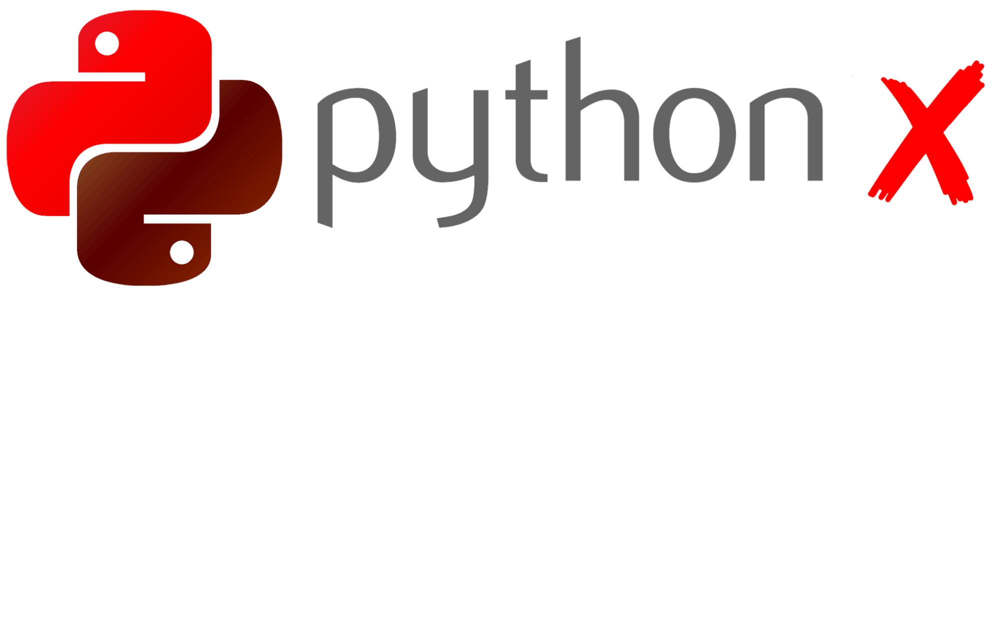

O Python X é uma ferramenta desenvolvida durante minha jornada de aprendizado em Python. 🚀

Criei este projeto para colocar meus conhecimentos em prática, aprender novas técnicas de programação e desenvolver minhas próprias ferramentas.

Agora, estou compartilhando o Python X com a comunidade para que outras pessoas possam conhecer o projeto, estudar seu código, aprender com ele e utilizá-lo como inspiração para suas próprias criações.

💻 Por que compartilhar?

Compartilhar conhecimento com outros programadores. Ajudar iniciantes a aprender Python. Incentivar o aprendizado através de projetos reais. Mostrar minha evolução como programador. 

🌱 Este projeto faz parte da minha jornada como desenvolvedor. Ainda estou aprendendo, experimentando e melhorando minhas habilidades, e espero que o Python X também possa ajudar outras pessoas a aprenderem.

Feito com Python e dedicação por um programador iniciante. 💚

Aprender, criar e compartilhar!

Projeto ainda em desenvolvimento.

Instruções:
Quando executar ele ira procurar
arquivos essenciais dependendo do tipo
do arquivo compactado que abaixou,
caso ele não encontre ele tentara
cria-los automaticamente, o programa
também contém um sistema de instalação
de bibliotecas e compilador de arquivos
em testes.
